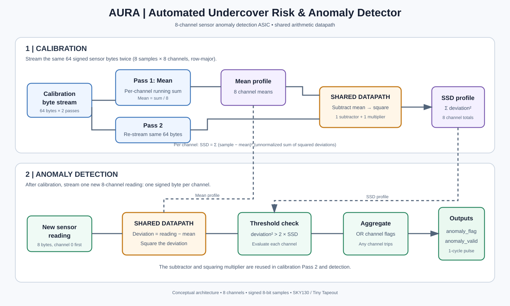

# AURA — Full Project Documentation

**AURA:** Automated Undercover Risk & Anomaly Detector  
**Program:** MIT Beaver Works Summer Institute (BWSI), Basics of ASICs  
**Team:** OpenLane Odyssey  
**Implementation:** SystemVerilog · SKY130 · Tiny Tapeout

## 1. Project overview

AURA is an eight-channel sensor anomaly detector implemented as a small digital hardware design. Its purpose is to learn a baseline from a set of calibration readings and then identify later readings that differ sufficiently from that baseline.

The design is organized into two operating stages:

1. **Calibration:** A stream of reference samples is used to calculate a mean and a measure of spread for each sensor channel.
2. **Detection:** New samples are compared with the stored per-channel baseline. A channel is marked when its squared deviation exceeds the threshold derived from its calibration profile. If any channel is marked during a complete reading, AURA reports an anomaly.

The current implementation is a compact, sequential design. It reuses a subtractor and squaring multiplier across calibration and detection instead of building separate arithmetic units for every operation.

## 2. Architecture overview

The diagram shows the main dataflow. Calibration produces two stored profiles: the **mean profile** and the **sum-of-squared-deviations (SSD) profile**. During detection, the current sample is compared with the corresponding channel mean, and its squared deviation is checked against that channel's stored threshold.

The architecture is **per-channel**: it does not calculate cross-channel covariance or a full covariance matrix. The SSD value is an unnormalized sum of squared deviations, not a normalized statistical variance. Those distinctions matter when interpreting the algorithm and its thresholds.

## 3. Sensor data format

| Property | Current design |
|---|---|
| Number of channels | 8 |
| Sample width | 8 bits |
| Sample interpretation | Signed two's-complement values |
| Calibration set | 8 samples per channel |
| Calibration input volume | 64 bytes per pass |
| Calibration passes | 2 |
| Detection input | 8 bytes per reading, one channel at a time |

Calibration samples are streamed in row-major order: each of the eight sample rows contains one value for each of the eight channels. The same 64-byte calibration set is supplied for both passes.

## 4. Calibration

Calibration builds a baseline independently for each channel. It uses two passes over the calibration input.

### 4.1 Pass 1 — calculate the channel means

For each channel, AURA accumulates its eight calibration samples:

\[
S_i = \sum_{k=0}^{7} x_{k,i}
\]

The mean is calculated by dividing the sum by eight. In the hardware, division by eight is implemented as an arithmetic right shift by three bits:

\[
\mu_i = S_i \texttt{>>>} 3
\]

Here, \(x_{k,i}\) is calibration sample \(k\) from channel \(i\), and \(\mu_i\) is that channel's stored mean. Because this is signed integer hardware arithmetic, the result follows arithmetic-right-shift semantics rather than floating-point division.

The design stores one mean for each of the eight channels in the mean profile.

### 4.2 Pass 2 — calculate the SSD profile

The same calibration samples are streamed again. For each sample, the design subtracts its channel's stored mean, squares the deviation, and adds the result to that channel's running total:

\[
SSD_i = \sum_{k=0}^{7}(x_{k,i}-\mu_i)^2
\]

The final total is stored in the SSD profile (the RTL may refer to this storage as `variance_profile`). This is an **unnormalized sum of squared deviations**. It is not divided by eight or by seven, and it is not a full variance-covariance calculation.

## 5. Anomaly detection

After calibration, AURA receives a new reading as eight sequential signed bytes, one byte per channel.

For each channel \(i\), it calculates the deviation from the stored mean and squares it:

\[
d_i = r_i - \mu_i
\]

\[
d_i^2 = (r_i-\mu_i)^2
\]

The channel is marked as anomalous when:

\[
d_i^2 > 2 \times SSD_i
\]

The comparison is performed independently for each channel. AURA aggregates the channel results: if any channel exceeds its threshold during the reading, the anomaly flag is asserted. The `anomaly_valid` output indicates when the result for the completed eight-byte reading is valid; in the current design it pulses one cycle after the eighth sample is received.

The multiplier and subtractor are reused from calibration Pass 2. The stored mean and SSD profiles provide the reference values during detection.

## 6. Hardware architecture and resource optimization

### 6.1 Shared arithmetic datapath

Rather than instantiate separate arithmetic hardware for every stage, the controller selects the appropriate inputs and reuses:

- A subtractor to calculate the deviation from the channel mean.
- A multiplier to square the deviation.
- Accumulators and profile storage to retain calibration results.

During calibration Pass 2, the squared deviation is added to the channel's SSD total. During detection, the same squared-deviation result is sent to the threshold comparison.

This sequential resource-sharing strategy reduces the amount of duplicated arithmetic logic. The implementation was structured to fit within **two Tiny Tapeout tiles**, compared with an earlier matrix-multiplication-based approach that required nine or more tiles.

### 6.2 Control and sequencing

A byte counter tracks progress through the calibration streams and detection reading. Channel indexing selects the corresponding mean and SSD entries. The controller sequences the two calibration passes and then the detection operations, while multiplexers route values through the shared datapath.

The design uses parameter declarations such as `N`, `DW`, `SUM_W`, `DEV_W`, and `VAR_W` to describe channel count and datapath widths. The implemented and verified configuration described here is the eight-channel, eight-bit design; changing parameters should not be assumed to work without checking all dependent widths, counters, arrays, and wrapper logic.

## 7. Tiny Tapeout hardware interface

The Tiny Tapeout wrapper exposes the data and control signals through the standard input/output buses.

| Signal | Bit(s) | Purpose |
|---|---:|---|
| `ui_in` | `[7:0]` | Serial 8-bit sensor/calibration data byte |
| `uio_in` | `[0]` | Calibration start control |
| `uio_in` | `[1]` | Calibration input/load enable |
| `uio_in` | `[2]` | Detection input/load enable |
| `uo_out` | `[0]` | `calib_done` — calibration completion status |
| `uo_out` | `[1]` | `anomaly_flag` — indicates that an anomaly was detected |
| `uo_out` | `[2]` | `anomaly_valid` — indicates that the completed reading's result is valid |
| `uio_out` | all | Driven to zero in the current wrapper |
| `uio_oe` | all | Driven to zero in the current wrapper |

The table documents the wrapper-level mapping. For exact cycle-by-cycle control timing, consult the top-level RTL and its testbench; do not infer a complete transaction protocol from the signal names alone.

## 8. Verification

The project includes testbench-based verification using cocotb and SystemVerilog self-checking tests. These tests exercise the calibration and detection flow and check the design's outputs against expected behavior.

For a reproducible result, run the repository's documented simulation commands and report the simulator, test names, and pass/fail output in the project repository. A testbench's existence should not be presented as proof of exhaustive verification.

## 9. Implementation flow

The design is written in SystemVerilog and targets the SKY130 process using the Tiny Tapeout / OpenLane flow. The project work includes RTL development, simulation and debugging, synthesis/physical-design checks, and preparing the design for the Tiny Tapeout submission flow.

Relevant implementation details for this project include the SKY130 HD standard-cell library and the physical-design work required to resolve antenna-rule issues. The final repository should retain the actual configuration files and reports used for the submitted build so that implementation claims can be checked against the generated artifacts.

## 10. Design scope and limitations

AURA is an educational hardware prototype. Its current approach has several important limitations:

- **Independent channels:** It models each channel separately. It does not capture correlations between channels and does not compute a full covariance matrix.
- **Small calibration set:** Each channel's baseline is built from eight calibration samples. The quality of the baseline depends on whether those samples represent normal operation.
- **Fixed-point/integer arithmetic:** Means, deviations, squares, and thresholds use finite-width digital values. Integer shifts and finite-width storage can introduce truncation or overflow considerations.
- **Heuristic threshold:** The comparison `deviation² > 2 × SSD` is the implemented decision rule. It is not a universally calibrated statistical confidence bound.
- **No demonstrated field validation:** A successful simulation or Tiny Tapeout implementation does not establish reliable performance in a real deployment environment.

AURA should therefore be described as a compact prototype for exploring hardware-based anomaly detection, not as a validated security, safety, or production monitoring system.

## 11. Project resources

- **Project source:** See the SystemVerilog RTL and testbench files in this repository.
- **Architecture diagram (SVG):** [`docs/images/aura-architecture.svg`](images/aura-architecture.svg)
- **Architecture preview (PNG):** [`docs/images/aura_architecture_preview.png`](images/aura_architecture_preview.png)
- **Project overview:** [`README.md`](../README.md)

## 12. Acknowledgment

Developed as part of the **MIT Beaver Works Summer Institute (BWSI) Basics of ASICs** program by **Team OpenLane Odyssey**.
